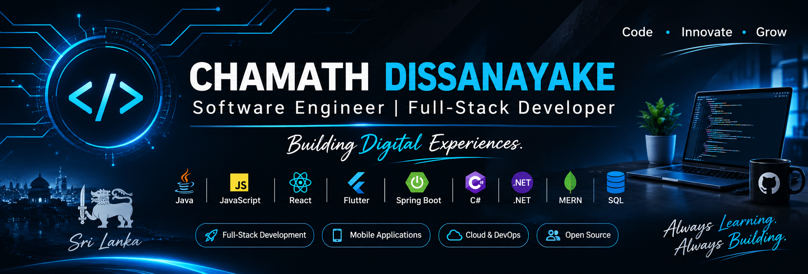

  

<h2 align="center">👋 Hello, I'm Chamath Dissanayake</h2>

<h3 align="center">
  Software Engineering Undergraduate | Full-Stack Developer
</h3>

  Passionate about building modern web applications,
  mobile solutions, and scalable software systems.

  
  

---

## 🚀 About Me

- 🎓 Software Engineering undergraduate at SLIIT.
- 💻 Interested in Full-Stack Software Development.
- 🌐 Building responsive web applications.
- 📱 Exploring cross-platform mobile development.
- ⚙️ Interested in backend engineering and database design.
- 🤝 Exploring new opportunities in Software Engineering , freelance projects,
  and collaborative development.

---
---

## 🛠️ Technology Stack

### Programming Languages

### Frontend Development

### Backend Development

### Mobile Development

### Databases

---

## 🤝 Connect With Me

- GitHub: [@Chamath0516](https://github.com/Chamath0516)
- LinkedIn: [chamath-dissanayake](https://www.linkedin.com/in/chamath-dissanayake/)
- Email : hmchprdissanayake@gmail.com
---

*Always building. Always learning. Always improving.*
